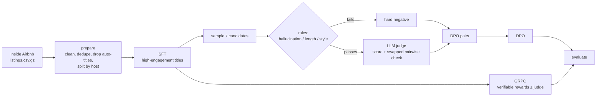

# Listing Title Optimizer

**Teaching a small open LLM to write Airbnb titles that get clicks without making things up.**
SFT → DPO → GRPO with verifiable rewards, on public Inside Airbnb data, reproducible end to end.

[](https://github.com/PulkitT01/listing-title-optimizer/actions/workflows/ci.yml)


🤗 **Demo:** _link to HF Space_ · **Model:** _link to HF model_ · **Dataset:** _link to HF dataset_

---

## Results

500 held-out listings from hosts never seen in training, `Qwen/Qwen3-1.7B` trained on my M4 Mac. Win
rate = `claude-sonnet-5-5` pairwise preference vs the host's original title (order-swapped,
ties = ½), with a 95% bootstrap CI. Generated in [`results/RESULTS.md`](results/RESULTS.md).

| System | Win rate vs original (95% CI) | Hallucination ↓ | ≤50 chars ↑ | Style issues ↓ |
|---|---|---|---|---|
| Original (host) | — | 3.0% | 100.0% | 2.4% |
| Base model | 36.1% (32.1–40.2%) | 4.0% | 23.8% | 0.4% |
| SFT | 65.3% (61.3–69.4%) | 0.8% | 97.2% | 0.0% |
| SFT + DPO | **68.5%** (64.4–72.3%) | **0.2%** | 99.8% | 0.0% |
| SFT + GRPO | 67.7% (63.8–71.4%) | **0.2%** | **100.0%** | 0.0% |

SFT does most of the work. DPO and GRPO both cut hallucinations further and land within each other's
confidence intervals, so neither clearly beats the other at this scale.

**Judge reliability:** fair at best. I hand-labelled 50 DPO preference pairs, and the Sonnet judge
agreed with me on 64% of them (95% CI 50–78%; Cohen's κ = 0.29, CI 0.04–0.56). These pairs are the
best and worst of the model's own candidates after the verifiable checks, so they are hard to tell
apart, but read the win rates as "Sonnet prefers it" rather than as a checked human preference. The
hallucination, length and style columns are rule-based and don't use the judge.

| Listing (excerpt) | Original | SFT + GRPO |
|---|---|---|
| Steps from Central Park … family-friendly two bedroom … ground floor of a brownstone with its own private garden | Lenox Hill two bedroom w/ garden | Brownstone Garden Apt in Upper East |
| Murray Hill, one block from the river … Midtown luxury apartments … gorgeous rooftop deck | Furnished nr Time Sqr 1BR nr East River | Luxury Midtown Apartment with Rooftop Deck |
| A bright double room … in a riverside apartment on the Liffey, with your own bathroom … | Room with Private Bathroom | Double room in riverside apartment |

## Why this project

A title is the first thing a guest reads, and an LLM can easily write catchy ones. The hard part is
**catchy and true**: a model that adds a "hot tub" the listing doesn't have will win clicks and lose
reviews. This repo treats faithfulness as a *verifiable* reward and compares two ways of learning
from preferences:

- **DPO** on pairs labelled by rules plus an LLM judge (offline, cheap, stable)
- **GRPO** with programmatic rewards: length, Airbnb style rules, and *no unsupported feature
  claims*, optionally mixed with a judge score (online, explores more)

## How it works



| Stage | What | Code |
|---|---|---|
| Data | Download, clean, filter English, drop Airbnb's auto-generated titles, split by host | [`data/`](src/title_optimizer/data) |
| Rewards | Hallucinated-amenity detector, length and style checks (TRL reward signature) | [`rewards.py`](src/title_optimizer/rewards.py) |
| Judge | Claude Code or OpenAI-compatible LLM judge with order swapping and caching; offline rule judge | [`judge.py`](src/title_optimizer/judge.py) |
| Preferences | Candidates → rule filter → judge → DPO pairs | [`preferences.py`](src/title_optimizer/preferences.py) |
| Training | SFT / DPO / GRPO with TRL + LoRA (optional QLoRA) | [`train.py`](src/title_optimizer/train.py) |
| Evaluation | Win rate with CIs, hallucination rate, judge–human agreement | [`evaluate.py`](src/title_optimizer/evaluate.py) |

## Quickstart

Requires [uv](https://docs.astral.sh/uv/). Training runs on one GPU or a 24 GB Apple Silicon Mac,
where the 1.7B model peaks around 13 GB and a full run takes about 18 hours (stage times in
[`docs/design-decisions.md`](docs/design-decisions.md)). On a Mac, run long stages under
`caffeinate -ims` so it doesn't sleep. `load_in_4bit: true` needs an NVIDIA GPU. Everything else
runs on CPU.

```bash
git clone https://github.com/PulkitT01/listing-title-optimizer && cd listing-title-optimizer
uv sync                      # add --extra cuda for QLoRA, --extra app for the demo
make test-all                # unit tests + an offline end-to-end run on a tiny model

claude                       # log in to Claude Code once; the judge runs on it, see configs/judge.yaml
make all                     # data → sft → preferences → dpo → grpo → eval
```

Every stage is one command with one YAML config:

```bash
uv run title-opt download                        # Inside Airbnb snapshots → data/raw (+ MANIFEST.json)
uv run title-opt prepare                         # → data/processed/{train,val,test,sft_train}.jsonl
uv run title-opt train -c configs/sft.yaml
uv run title-opt preferences -c configs/preferences.yaml
uv run title-opt train -c configs/dpo.yaml
uv run title-opt train -c configs/grpo.yaml --judge-config configs/judge.yaml
uv run title-opt label data/preferences/dpo_train.jsonl  # label 200 pairs yourself
uv run title-opt judge-agreement                 # how much should we trust the judge?
uv run title-opt evaluate -c configs/eval.yaml   # → results/RESULTS.md
```

No Claude Code? `JUDGE_MODEL=rules` swaps in a deterministic rule-based judge so the whole pipeline
runs offline (results then only reflect the verifiable rewards).

## Data

[Inside Airbnb](https://insideairbnb.com/get-the-data/) quarterly snapshots (London, New York,
Sydney, Toronto, Dublin by default), licensed **CC BY 4.0**. Fields used: `name` (title),
`description`, `amenities`, `property_type`, `neighbourhood_cleansed`, `number_of_reviews`,
`reviews_per_month`, `review_scores_rating`. The results above use the September 2026 snapshots
(14–17 Sep): 171,503 raw listings, 142,919 after cleaning.

Things worth knowing (and handled in [`prepare.py`](src/title_optimizer/data/prepare.py)):

- **Some `name` values aren't host titles.** Some snapshots contain Airbnb's generated card text
  (`Rental unit in Brooklyn · ★4.9 · 1 bedroom · 1 bed · 1 bath`). These are detected and dropped;
  `stats.json` reports how many. The September 2026 snapshots had only 161.
- **Descriptions contain HTML**, which is stripped.
- **Engagement is a weak label.** "High engagement" means at least 5 reviews, a rating of 4.7 or
  higher, and reviews/month in the top third *within the same city*. Price, photos and location
  confound it, so it's used only to pick SFT targets, never as ground truth.
- **Splits are by host**, so templated titles from multi-listing hosts can't leak into the test set.
- **Free snapshots rotate out after ~12 months.** Resolved URLs and SHA-256 hashes are written to
  `data/raw/MANIFEST.json`, and the processed dataset is published on the Hugging Face Hub so results
  stay reproducible.

## Design decisions

- **Model:** `Qwen/Qwen3-1.7B` (Apache-2.0), small enough to train on a Mac. It's a hybrid-thinking
  model, so `load_tokenizer` turns thinking off and all 32 completion tokens go to the title. Swap
  in any chat model via `base_model`.
- **Adapters are chained:** DPO and GRPO train a fresh LoRA on top of the *merged* SFT model, so SFT
  is also the DPO reference model. Evaluation applies the same chain (`[sft, dpo]`).
- **Judge bias controls:** pairwise prompts are asked in both orders, and disagreement counts as a
  tie. All calls are cached in `.cache/judge.jsonl`, so reruns are free and deterministic.
- **Cheap pair construction:** rule-failing candidates become hard negatives without any judge
  call. The rest get k pointwise scores plus one swapped pairwise confirmation, instead of a full
  round robin.

## Limitations & next steps

- The hallucination detector is lexicon-based (22 claim types). It misses paraphrases and can't
  check numeric claims ("3BR") or location claims ("5 min to the beach"). An NLI-based checker is
  the obvious next step.
- An LLM judge isn't a guest. The real test would be an online A/B on click-through rate.
- Train a reward model on engagement, controlling for price and location, and compare it to the judge.

## Project structure

```
├── configs/                 # one YAML per stage
├── src/title_optimizer/
│   ├── data/                # download.py, prepare.py
│   ├── prompts.py  rewards.py  judge.py  modeling.py
│   ├── preferences.py  train.py  evaluate.py  cli.py
├── app/app.py               # Gradio demo (HF Spaces)
├── tests/                   # unit tests + offline tiny-model end-to-end test
├── results/                 # committed metrics and samples
├── docs/                    # design decisions, measured stage times, known limitations
├── TODO.md                  # open tasks
└── Makefile
```

## Acknowledgements

Data © [Inside Airbnb](https://insideairbnb.com), CC BY 4.0. Training is built on Hugging Face
[TRL](https://github.com/huggingface/trl), [PEFT](https://github.com/huggingface/peft) and
[Transformers](https://github.com/huggingface/transformers).

This project is a rebuild of my earlier
[NLP-Title-Optimization](https://github.com/PulkitT01/NLP-Title-Optimization) (Phi-3.5 + DPO with
hand-labelled pairs).
